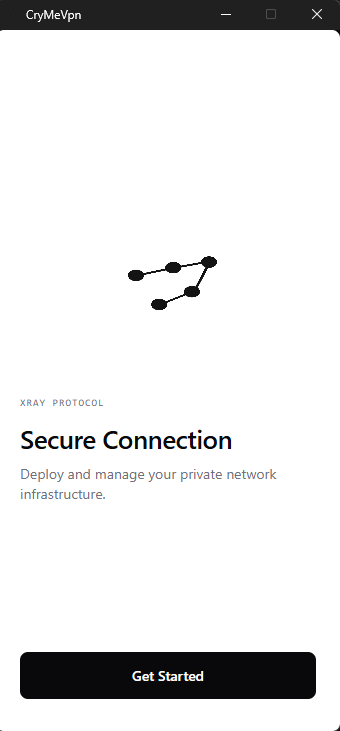

# Cry{mevpn}
<p align="center">
  
</p>


**A desktop VPN client built on the Xray core. It deploys your own VPN server to your VPS in a few clicks.**



## Why Cry{mevpn}?

- No third-party servers: you use your own VPS
- No log storage
- No selling of your data
- No console hassle: no manual commands on the server

## Features

- Deploys Xray to a VPS over SSH (using Docker)
- VLESS + Reality support, with options for the camouflage domain, TLS fingerprint and DNS
- Local HTTP/SOCKS proxies with configurable ports
- Automatic system proxy configuration (Windows, GNOME)
- System tray icon (Windows)
- Encrypted storage for server configurations

## How does it work?

```
Deploy:   Application ──(SSH)──> VPS: Docker + Xray

Traffic:  Browser ──> local proxy ──> Xray client ──> VPS ──> Internet
```

## Privacy and security

- **Server logs are disabled.** The generated server config contains:
    
    ```json
    "log": {
      "loglevel": "warning",
      "access": "none"
    }
    ```
    
    You can verify it yourself on the server. Run `docker ps` to find the container, then `docker logs <container>`: there must be no `accepted ...` lines, only Xray startup messages. Docker logs are also capped at 1 MB.
    
- The project does not own any servers or accounts.
    
- Saved servers are stored on your computer in encrypted form.
    
- Cry contacts GitHub only to download the Xray binary on the first launch.
    
- The provider of your VPS is a separate matter: Cry cannot control what your hosting provider records.
    
- SSH host key verification is not implemented yet (planned).
    

## Installation

**Requirements:** a Linux VPS with root access and an open port. Docker is installed automatically if it is missing.

### Windows

1. Download the `.exe` from the Releases page.
2. Verify its SHA256 hash against the value in the release notes (PowerShell: `Get-FileHash .\Cry.exe`).
3. Run it.

### Linux (GNOME)

1. Install the runtime dependencies (package names may differ by distribution):
    
    ```bash
    sudo apt install libgtk-3-0 libwebkit2gtk-4.0-37
    ```
    
2. Download the binary from the Releases page and run it:
    
    ```bash
    chmod +x Cry
    ./Cry
    ```
    

## Getting started

1. Click **Get started** and enter the IP address of your VPS, the SSH port, the Xray port, the user and the password (or a private key).
2. Click **Deploy Server** and wait until the server is configured.
3. Click **Connect**.
4. Check your new IP address, for example on [ip8.com](https://ip8.com).

Advanced users can open the **Advanced** panel:

|Setting|What it does|Default|
|---|---|---|
|Camouflage domain|The site your server pretends to be (Reality)|`www.openssl.org`|
|Camouflage port|Port of the camouflage domain|`443`|
|Fingerprint|TLS fingerprint of the client|Firefox|
|DNS|DNS server used by the VPS|Cloudflare|
|Local HTTP port|Port of the local HTTP proxy|`10809`|
|Local SOCKS port|Port of the local SOCKS proxy|`10808`|

Using port `443` for Xray is recommended: Reality traffic looks the most natural there.

## Common issues

- **Xray takes a long time to download.** Download it manually from [Xray-core releases](https://github.com/XTLS/Xray-core/releases) and place `xray.exe` into the `...\CryMeVpn\bin\` folder.
- **"Port already in use".** Stop the old process: `taskkill /F /IM xray.exe` (Windows).
- **SSH fails to connect.** Check the IP address, the SSH port and the password.
- **No internet after the application crashed.** Turn off the system proxy:
    - Windows: _Settings → Network & Internet → Proxy_
    - GNOME: _Settings → Network → Network Proxy → Disabled_

## Building from source

Requirements: [Go](https://go.dev/), [Node.js](https://nodejs.org/) and [Wails v2](https://wails.io/).

```bash
go install github.com/wailsapp/wails/v2/cmd/wails@latest

git clone https://github.com/StarsMage/CryMeVPN.git
cd CryMeVPN

wails dev     # development mode
wails build   # production build
```

Linux dependencies: `libgtk-3-dev` and `libwebkit2gtk-4.0-dev`. On newer distributions (for example Ubuntu 24.04) use `libwebkit2gtk-4.1-dev` and build with `wails build -tags webkit2_41`.

## Roadmap

- SSH host key verification
- TUN mode
- macOS support
- Connect/Disconnect from the tray
- Settings screen
- Privacy enhancements

## License and acknowledgments

Cry{mevpn} is released under the MIT License.

Thanks to:

- [Xray-core](https://github.com/XTLS/Xray-core) (MPL-2.0)
- [Wails](https://github.com/wailsapp/wails)
- [AmneziaVPN](https://github.com/amnezia-vpn/amnezia-client), my idol

## Disclaimer

- Use this software in accordance with the laws of your country.
- The user assumes full responsibility for its use.

[](https://star-history.com/#StarsMage/CryMeVPN&Date)
